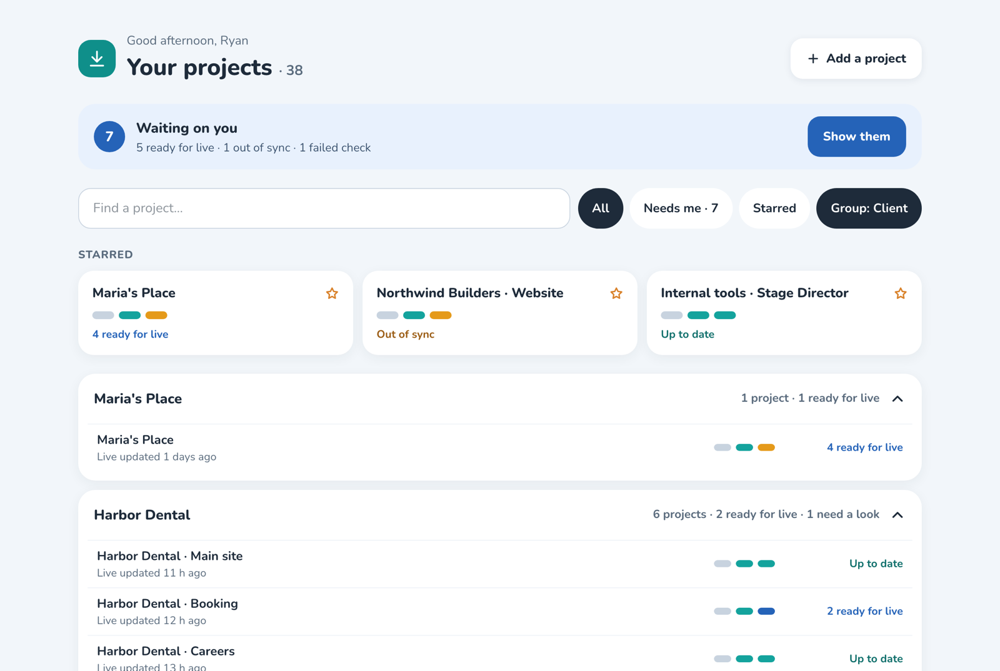
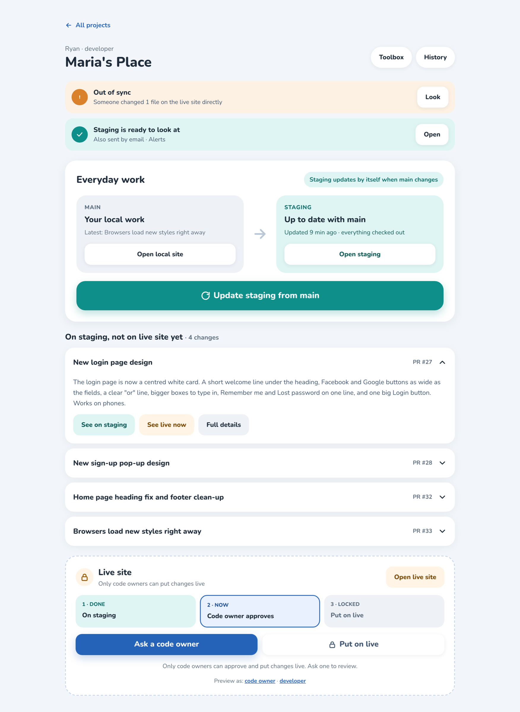
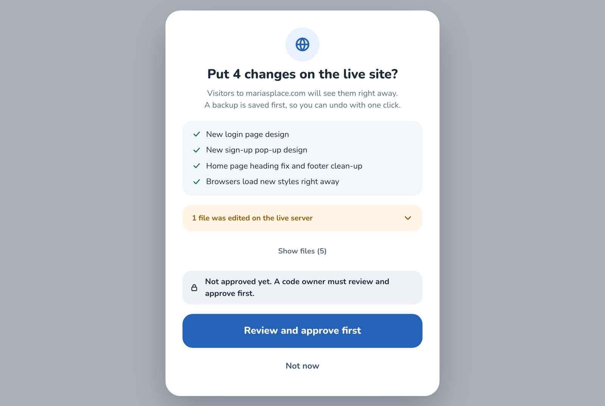
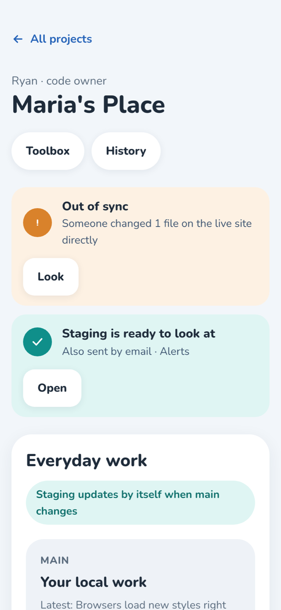
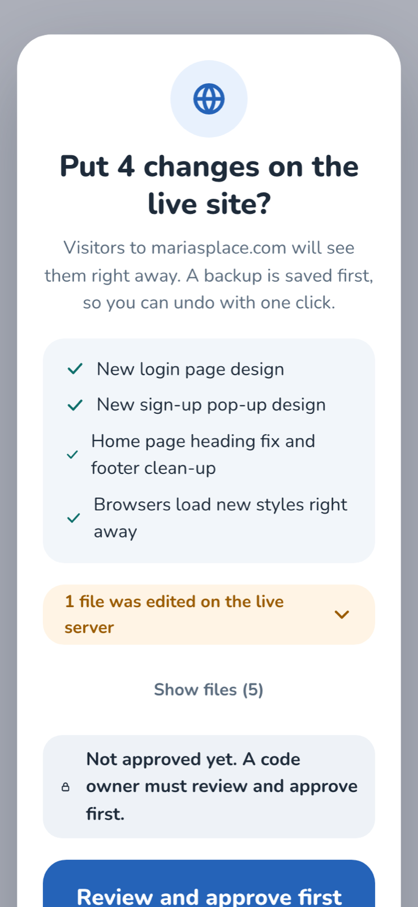
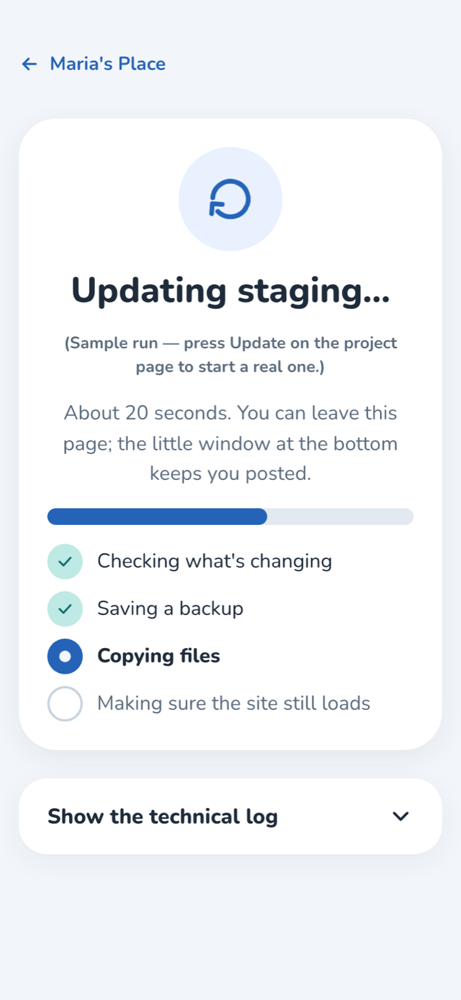

<div align="center">

# 🎬 Stage Director

**A friendly deploy dashboard for all your sites.**
Code moves **local → staging → live**. Anyone on the team can update staging.
Only code owners can put anything live, and every live push has a backup and a one-click undo.



</div>

---

## Why

Unfinished changes reaching a live site is how sites go down. Stage Director makes the safe path the easy one:

- **One screen for every project.** See what's on each stage, what's waiting, and what needs you.
- **Big, plain-English buttons.** "Update staging from main", "Put 4 changes on the live site?" No terminals, no jargon.
- **Live is locked.** Only a person listed as a code owner can approve and push live. Scripts, bots and AI sessions cannot.
- **Safety net.** Every push saves a backup first. If the site stops loading afterwards, it's put back by itself.

## A tour

### All your projects

Grouped by client, with a coloured dot for each stage, starred favourites, and a **Waiting on you** banner listing what's ready for live, out of sync, or failed.


### A project

Everyday work up top: your branch on the left, staging on the right, one big button between them. Banners above say what needs attention. Below, the changes that are on staging but not on the live site yet, each in plain English.


The page adapts to who you are. A **code owner** gets **Review and approve**, then **Put on live**. A **developer** sees the same steps with **Ask a code owner** instead, and live stays locked.

<table>
<tr>
<td width="50%"><br><sub><b>Developer view</b>: live is locked, "Ask a code owner"</sub></td>
<td width="50%"><br><sub><b>Before you put it live</b>: before & after for each change, then the to-do list for live</sub></td>
</tr>
</table>

### Putting it live

The live button says exactly what will change and who will see it. It warns when files were edited on the server outside git, and it won't go until a code owner has approved this exact version.



### Watching it happen

A friendly progress view: checking what's changing, saving a backup, copying files, making sure the site still loads. You can leave the page; a small window keeps you posted. The full technical log is one click away.


### History, Toolbox and banners

<table>
<tr>
<td width="50%"><br><sub><b>History</b>: every update, approval, pause and undo, by whom and when</sub></td>
<td width="50%"><br><sub><b>Toolbox</b>: clear cache, back up, copy live to staging, update plugins, Safety net, Sync check, Site watch, Quiet hours</sub></td>
</tr>
<tr>
<td colspan="2"><br><sub><b>Banners</b>: someone is updating, out of sync, Safety net undid an update, quiet hours, staging ready to look at</sub></td>
</tr>
</table>

### On your phone

Every screen works at phone width, with big rounded buttons.

<table>
<tr>
<td></td>
<td></td>
<td></td>
<td></td>
</tr>
</table>

## Features

| | |
|---|---|
| 🗂️ **Many projects** | One dashboard for every site, grouped by client, with search, filters and stars |
| 🚦 **Stages in order** | local → staging → live; a version can only go live after it's been on staging |
| 🔐 **Code-owner live gate** | Only people in the project's `CODEOWNERS` can approve and push live, enforced in the workflow, not just the UI |
| ✅ **Approve this exact version** | An approval is tied to one commit; anything newer needs a new approval |
| 🛟 **Safety net** | Backup before every push; automatic undo if the smoke test fails; one-click undo afterwards |
| 🔎 **Sync check** | Flags files changed on the server outside git before they get overwritten |
| 📌 **Pin a stage** | Freeze staging or live so nothing moves until you unpin |
| 🌙 **Quiet hours** | No live updates outside working hours |
| 🧾 **History** | Who did what, when, with links to the full log |
| 📱 **Phone-friendly** | Every screen works on a phone |

## How it works

```
 Dashboard (Next.js)  ──starts──▶  GitHub Actions workflow  ──runs on──▶  self-hosted runner (ovh1)
        ▲                               │  checks the rules                    │ SSH, key from a
        └──── reads status, history ────┘  records Deployments                 ▼ GitHub Environment
                                                                     project's own deploy script → host
```

- **The dashboard never talks to hosting.** Its buttons start GitHub workflow runs; status, logs and history come from the GitHub API.
- **The engine** ([`engine/`](engine/)) is one workflow each project copies, plus the project's own deploy script. Before anything moves, the workflow checks who is asking, whether this exact commit is approved by a code owner, whether the previous stage is on that commit, and whether the stage is pinned. The host's SSH key lives only in a GitHub Environment that releases it only to runs from the main branch, with a separate key per stage.
- **The live lock** is two things together: a recorded approval of that exact commit by a person listed in `CODEOWNERS` (checked inside the workflow; bots and AI sessions can't pass), and live secrets that only `main` can use. On the current GitHub Pro plan with private repos, GitHub Environments can't require a reviewer. GitHub Enterprise, or a public repo, would add Environment required reviewers as a third lock. Details: [deploy contract](engine/contract.md#live-gate-what-the-workflow-checks).
- **Each project** has a `stagedirector.yml` describing its stages ([example](examples/mariasplace.stagedirector.yml)) and a deploy command that follows the [deploy contract](engine/contract.md).

| Where | What |
|---|---|
| [`src/app`](src/app), [`src/components`](src/components) | Screens |
| [`src/lib/github`](src/lib/github), [`src/lib/auth`](src/lib/auth) | GitHub data layer, sign-in, roles |
| [`src/lib/types.ts`](src/lib/types.ts) | Shared types |
| [`engine/workflow`](engine/workflow) | The workflow and live gate |
| [`engine/contract.md`](engine/contract.md) | What a project's deploy command must do |
| [`engine/runner`](engine/runner) | Runner setup for ovh1 (for the owner to run by hand) |

## Run it locally

```bash
npm install
```

```bash
STAGEDIRECTOR_DEV_LOGIN=your-login npm run dev
```

Without GitHub credentials it runs on **sample data** (what the screenshots show), and every button can be tried. To use real projects, copy `.env.example` to `.env.local` and fill in the GitHub OAuth app, a GitHub App or token, and `STAGEDIRECTOR_REPOS`.

## Adding a project

1. Add `stagedirector.yml` to the project's repo ([example](examples/mariasplace.stagedirector.yml)).
2. Copy [`engine/workflow/stagedirector.yml`](engine/workflow/stagedirector.yml) to `.github/workflows/`.
3. Make the deploy script follow the [contract](engine/contract.md).
4. Add a `CODEOWNERS` file, protect `main`, and create the `stagedirector-<stage>` environments ([runner guide](engine/runner/README.md)).
