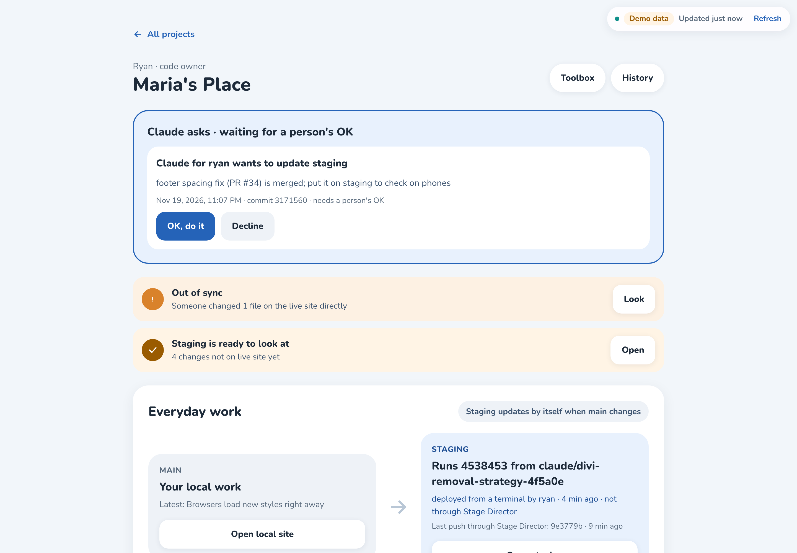
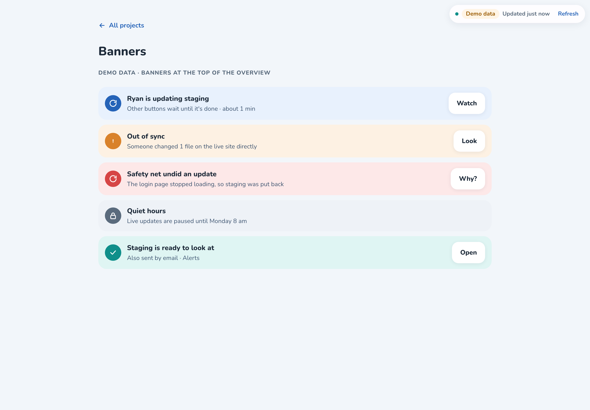
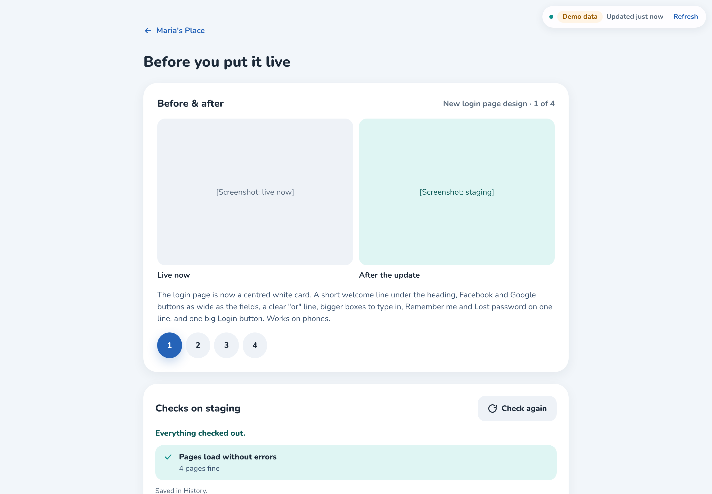
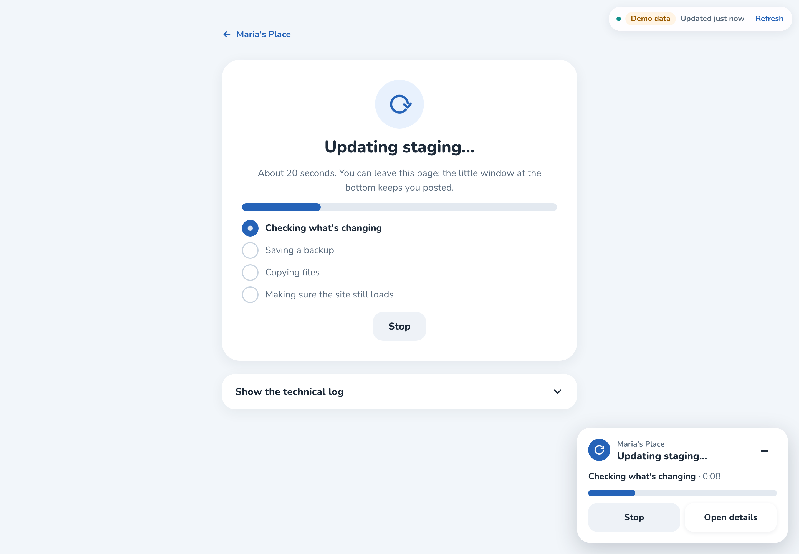
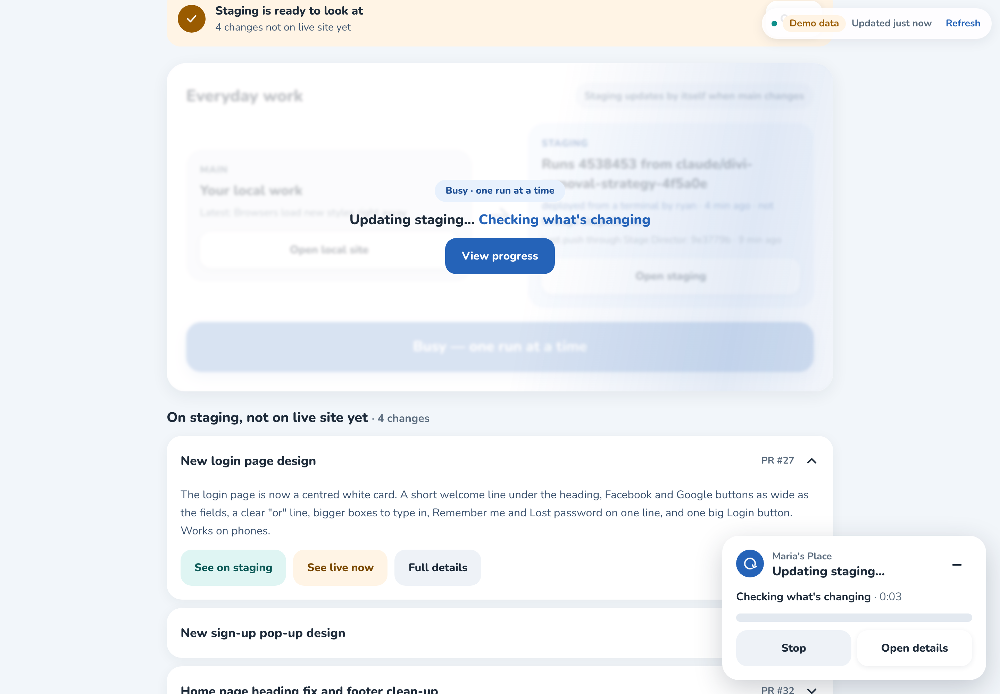
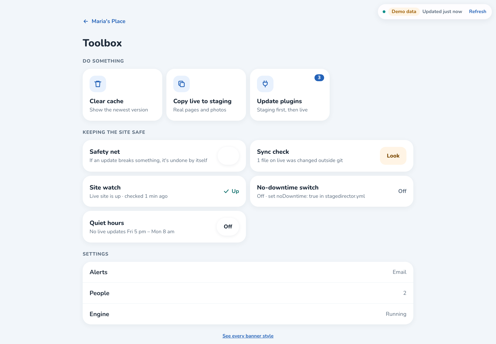
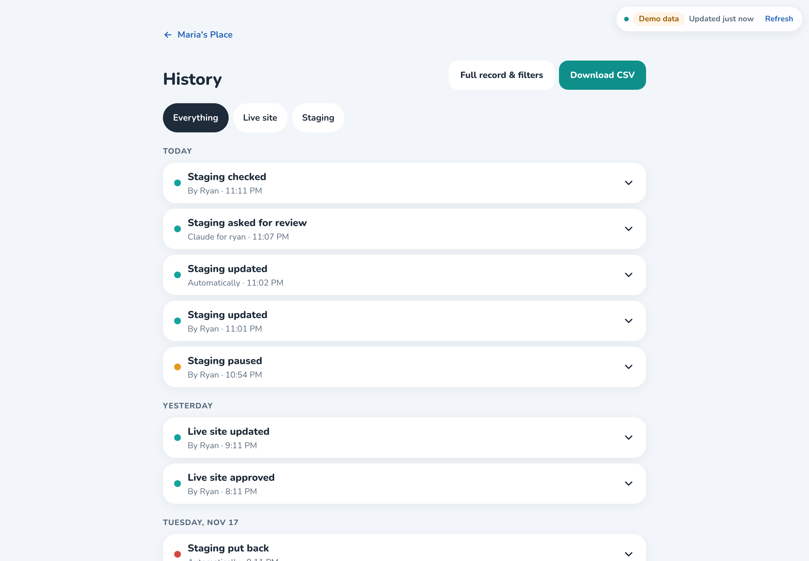
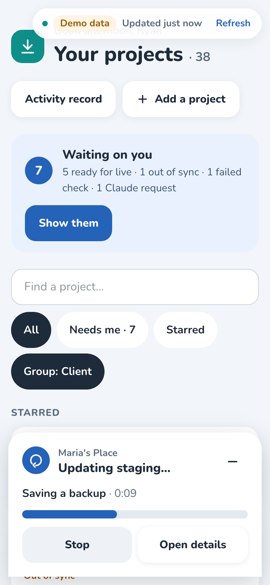

<div align="center">

# 🎬 Stage Director

### Every site. Every stage. One calm screen.

**The friendly deploy dashboard for teams who run lots of websites.**
Code moves **local → staging → live** with big, plain-English buttons.
Anyone on the team can update staging. Only code owners can put anything live.
Every live push saves a backup first, and undo is one click.


<sub>Self-hosted · Runs on GitHub Actions · Works on your phone</sub>

</div>

---

## Ship on a Friday. Sleep on a Friday.

Sites go down when unfinished work slips onto the live site, or when someone fixes a file on the server and the next deploy quietly wipes it out. Stage Director makes the safe path the easy one.

| | |
|---|---|
| 🧭 **See everything at a glance** | 5 sites or 50: what's on each stage, what's waiting, and what needs you. |
| 🔘 **Buttons, not terminals** | "Update staging from main." "Put 4 changes on the live site?" No jargon, no SSH. |
| 🔐 **Live is locked** | Only a person listed as a code owner can approve and push live. Scripts, bots and AI helpers can't. |
| 🛟 **A safety net under every push** | A backup is saved first. If the site stops loading, it's put back automatically. |

---

## All your sites, one screen

> *"What's waiting on me?" Answered before your coffee cools.*

Projects are grouped by client, with a coloured bar for each stage, starred favourites, search and filters. The **Waiting on you** banner adds up what's ready for live, what's out of sync, which checks failed, and which requests need a yes.


---

## Every change, in plain English

> *Know what you're shipping, not just which commit.*

Each project page puts everyday work up front: your branch on the left, staging on the right, one big button between them. Below that, every change sitting on staging but not on the live site yet gets a title and a summary anyone can read, with **See on staging** and **See live now** buttons side by side.



Banners say what needs attention before it turns into a problem:

- **Out of sync**: someone changed a file on the live server directly. Stage Director spots it before a deploy overwrites it.
- **Staging is ready to look at**: changes are waiting for a review.
- **Claude asks**: an AI assistant can *ask* to update staging, and a person says **OK, do it** or **Decline**.



---

## Going live, on purpose

> *The live button tells you exactly what will happen. Then it waits for the right person.*

Before anything reaches visitors, Stage Director shows the list of changes, warns about files edited on the server, and explains what kind of update it will be. It won't go until a **code owner has approved that exact version**. Anything newer needs a fresh approval.

<table>
<tr>
<td width="50%"><br><sub><b>Review and approve</b>: before and after for each change, then the to-do list for live</sub></td>
<td width="50%"><br><sub><b>Put it live</b>: what changes, who sees it, and how to undo</sub></td>
</tr>
</table>

**Developers** see the same steps with **Ask a code owner**. Live stays locked for them, and that rule is checked inside the deploy workflow itself, not just hidden in the UI.

---

## Watch it happen, or walk away

> *A progress bar you can actually read.*

Checking what's changing → saving a backup → copying files → making sure the site still loads. Leave the page if you like: a small window follows you around with the progress and a **Stop** button. While a run is going, the project dims so nobody starts a second one by mistake.

<table>
<tr>
<td width="50%"><br><sub><b>Progress</b>: four friendly steps, with the technical log one click away</sub></td>
<td width="50%"><br><sub><b>One run at a time</b>: the project dims and the run window keeps you posted</sub></td>
</tr>
</table>

---

## A toolbox for the jobs in between

> *Everything you used to SSH in for.*

Clear the cache, save a backup, copy live to staging, update plugins. Plus the switches that keep you safe: **Safety net**, **Sync check**, **Site watch** and **Quiet hours** (no live updates outside working hours).

<table>
<tr>
<td width="50%"><br><sub><b>Toolbox</b>: one-click maintenance jobs</sub></td>
<td width="50%"><br><sub><b>History</b>: who did what, when, with a link to the full log</sub></td>
</tr>
</table>

---

## Deploy from the couch

> *Every screen works at phone width, with thumb-sized buttons.*

<table>
<tr>
<td></td>
<td></td>
<td></td>
<td></td>
</tr>
</table>

---

## Everything in the box

| | |
|---|---|
| 🗂️ **Many projects** | Every site in one place, grouped by client, with search, filters and stars |
| 🚦 **Stages in order** | local → staging → live. Nothing reaches live without passing through staging first |
| 🔐 **Code-owner live gate** | Only people listed in the project's `CODEOWNERS` can approve and push live |
| ✅ **Approve this exact version** | An approval covers one commit. Anything newer needs a new approval |
| 🤖 **AI asks, people decide** | AI assistants can request a staging update. A person always presses OK |
| 🛟 **Safety net** | Backup before every push, automatic undo if the site stops loading, one-click undo afterwards |
| 💾 **Save a backup** | One-click off-site backup (e.g. UpdraftPlus to Backblaze) |
| 🔎 **Sync check** | Flags files changed on the server outside git before they get overwritten |
| 📌 **Pin a stage** | Freeze staging or live so nothing moves until you unpin |
| 🌙 **Quiet hours** | No live updates outside the hours you choose |
| 🧾 **Activity record** | Every update, approval, pin and undo, by whom and when |
| 💻 **Local mode** | See your uncommitted files and unpushed commits next to staging |
| 📱 **Phone-friendly** | Every screen, every button |

---

## Yours, not rented

- **Self-hosted.** Runs in Docker on your own server, reachable only over your private network (e.g. Tailscale). No public port.
- **Built on GitHub Actions.** Buttons start ordinary workflow runs on your own runner. The dashboard never holds your hosting keys; they stay in GitHub Environments.
- **Works with what you have.** Each project brings its own deploy script, whether that's WordPress on shared hosting, a Node app or a static site. Add a small `stagedirector.yml` and a workflow file, and it shows up on the dashboard.
- **No per-seat pricing.** It runs on your server, under your control.

---

## Try it in a minute

```bash
npm install
```

```bash
STAGEDIRECTOR_DEV_LOGIN=you npm run dev
```

Open http://localhost:53100. Without GitHub credentials it runs on **sample data** (what you see in these screenshots), and every button works.

To refresh the screenshots, start the demo on port 53110 and run `node scripts/screenshots.mjs`.

**Ready for real projects?** See **[Setup and internals](docs/SETUP.md)**: how it works, adding a project, running it on a server, tests, and the GitHub rate-limit budget.
